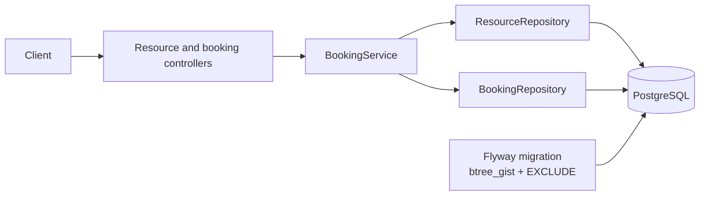

# Booking Service

[](https://github.com/Asyl-k/booking-service/actions/workflows/ci.yml)

A resource booking API built with Java 21 and Spring Boot. It prevents double bookings under concurrency with a PostgreSQL `EXCLUDE` constraint over time ranges, lets customers cancel and rebook slots, and returns RFC 9457 `ProblemDetail` errors.

## Stack

Java 21 · Spring Boot 3.5 · Spring Data JPA · PostgreSQL 17 · Flyway · Bean Validation · springdoc-openapi · JUnit 5 · Mockito · Testcontainers · Maven · Docker · GitHub Actions

## What it demonstrates

- **Database-enforced double-booking protection**: a `GiST` exclusion constraint on `(resource_id, tstzrange(starts_at, ends_at, '[)'))` makes overlapping confirmed bookings impossible, even when requests race.
- **Half-open intervals**: `[09:00, 10:00)` and `[10:00, 11:00)` are valid back-to-back bookings, while any real overlap is rejected.
- **Cancellation semantics**: cancelling changes the status and frees the slot, because the exclusion constraint only applies to `CONFIRMED` rows.
- **Honest HTTP contract**: `201` with `Location` on creation, `400` for invalid intervals, `404` for unknown resources/bookings, `409` for conflicts, all with a stable `code`.
- **Tests that prove concurrency**: ten parallel requests for the same slot produce exactly one `201` and nine `409`.

## Architecture



The controllers only translate DTOs. `BookingService` validates the interval and timestamps, loads the resource, persists the booking and maps database conflicts to a domain exception. The exclusion constraint is the final arbiter: application checks cannot be race-free on their own.

## Quick start with Docker

Requirements: Docker Desktop or Docker Engine with Compose v2.

```bash
cp .env.example .env
docker compose up --build
```

The API starts on `http://localhost:8080`; Swagger UI is at `http://localhost:8080/swagger-ui.html`.

## Run locally without Docker

Requirements: JDK 21, PostgreSQL 17 and Maven (or the included wrapper).

```bash
createdb bookings
export SPRING_DATASOURCE_URL=jdbc:postgresql://localhost:5432/bookings
export SPRING_DATASOURCE_USERNAME=your_user
export SPRING_DATASOURCE_PASSWORD=your_password
./mvnw spring-boot:run
```

Flyway enables `btree_gist`, creates the schema and adds the exclusion constraint. Hibernate runs with `ddl-auto: validate`, so entity/migration drift fails startup.

## API

| Method | Path | Description |
|---|---|---|
| `POST` | `/api/resources` | Create a bookable resource |
| `GET` | `/api/resources` | List resources; `page`, `size`, `sort` |
| `GET` | `/api/resources/{id}` | Resource details |
| `POST` | `/api/bookings` | Create a booking |
| `GET` | `/api/bookings/{id}` | Booking details |
| `POST` | `/api/bookings/{id}/cancel` | Cancel a booking; idempotent |
| `GET` | `/api/resources/{id}/bookings` | Bookings for a resource; optional `status` filter |

### Walkthrough

Create a resource and book a two-hour slot:

```bash
ROOM=$(curl -sS -X POST http://localhost:8080/api/resources \
  -H 'Content-Type: application/json' \
  -d '{"name":"Conference Room A"}')
ROOM_ID=$(echo "$ROOM" | jq -r .id)

curl -sS -X POST http://localhost:8080/api/bookings \
  -H 'Content-Type: application/json' \
  -d "{
    \"resourceId\": $ROOM_ID,
    \"customerName\": \"Alice\",
    \"startsAt\": \"2027-01-10T09:00:00Z\",
    \"endsAt\": \"2027-01-10T11:00:00Z\"
  }"
```

An overlapping request returns `409`:

```bash
curl -sS -X POST http://localhost:8080/api/bookings \
  -H 'Content-Type: application/json' \
  -d "{
    \"resourceId\": $ROOM_ID,
    \"customerName\": \"Bob\",
    \"startsAt\": \"2027-01-10T10:30:00Z\",
    \"endsAt\": \"2027-01-10T12:00:00Z\"
  }"
```

```json
{
  "title": "Booking conflict",
  "status": 409,
  "detail": "The requested interval [2027-01-10T10:30:00Z, 2027-01-10T12:00:00Z) overlaps an existing booking for resource 1",
  "code": "booking_conflict",
  "timestamp": "2026-11-19T00:00:00Z"
}
```

Cancel the booking and the same slot becomes bookable again:

```bash
curl -sS -X POST http://localhost:8080/api/bookings/1/cancel
```

List bookings, optionally filtered by status:

```bash
curl -sS "http://localhost:8080/api/resources/$ROOM_ID/bookings?status=CONFIRMED"
curl -sS "http://localhost:8080/api/resources/$ROOM_ID/bookings?status=CANCELLED"
```

## Rules

- `endsAt` must be strictly after `startsAt`; otherwise `400 invalid_interval`.
- `startsAt` must be in the future; otherwise `400 starts_at_in_past`.
- The resource must exist; otherwise `404 resource_not_found`.
- Timestamps are `Instant` values in UTC, serialized as ISO-8601.
- A booking starts as `CONFIRMED`. Cancelling sets `status = CANCELLED` and `cancelledAt`.
- Cancelling an already cancelled booking returns `200` with the original `cancelledAt`, so retries are safe.

## How the exclusion constraint works

```sql
CREATE EXTENSION IF NOT EXISTS btree_gist;

ALTER TABLE bookings
    ADD CONSTRAINT ex_bookings_confirmed_no_overlap
    EXCLUDE USING gist (
        resource_id WITH =,
        tstzrange(starts_at, ends_at, '[)') WITH &&
    )
    WHERE (status = 'CONFIRMED');
```

- `btree_gist` lets a GiST index combine an equality check (`resource_id`) with a range overlap check.
- `tstzrange(..., '[)')` treats the end as exclusive, so adjacent bookings do not conflict.
- The `WHERE status = 'CONFIRMED'` predicate excludes cancelled rows from the constraint, which is what frees the slot.
- PostgreSQL evaluates the constraint inside the insert, so two concurrent overlapping inserts cannot both succeed. The loser receives an integrity violation, which the service maps to `409 booking_conflict`.

No `SELECT ... FOR UPDATE` or pre-check query is needed for correctness. The database is the single source of truth.

## Concurrency test

`BookingApiIntegrationTest` starts ten parallel HTTP requests for the same resource and slot:

- exactly one request gets `201`;
- the other nine get `409 booking_conflict`;
- the resource has exactly one confirmed booking afterwards.

Cancellation uses a pessimistic row lock so that repeated cancels are serialized and the first `cancelledAt` wins. After cancellation, the slot is immediately available and a rebooking succeeds.

## Error format

All errors use `application/problem+json` and a stable `code` field:

| Status | Code | When |
|---|---|---|
| `400` | `validation_failed` | Missing/invalid fields, blank name |
| `400` | `invalid_interval` | `endsAt` is not after `startsAt` |
| `400` | `starts_at_in_past` | `startsAt` is not in the future |
| `400` | `malformed_request` | Missing or invalid JSON |
| `404` | `resource_not_found` | Unknown resource |
| `404` | `booking_not_found` | Unknown booking |
| `409` | `booking_conflict` | Overlapping confirmed booking |
| `500` | `internal_error` | Unexpected server error |

## Tests

```bash
./mvnw test      # 20 unit tests, no Docker required
./mvnw verify    # unit + 8 PostgreSQL integration tests via Testcontainers
```

Integration tests are annotated with `@Testcontainers(disabledWithoutDocker = true)`: they are skipped on a machine without Docker and run against `postgres:17-alpine` in GitHub Actions. They cover adjacent slots, partial and full overlaps, cancellation and rebooking, status filtering, validation errors, concurrent bookings of different resources and the ten-way race for one slot. The CI pipeline also builds the image, starts the Compose stack, waits for `/actuator/health` and repeats the main flow through Docker.

## Design decisions

- **Exclusion constraint instead of a service-level check.** A `find overlapping` query followed by an insert has a race window. The constraint closes it without distributed locks or serializable transactions.
- **Half-open intervals.** They make back-to-back bookings expressible without gaps or special cases.
- **Partial constraint for cancellation.** Keeping cancelled rows preserves history while releasing the time range.
- **Status filter in the API.** Users can inspect history and the current schedule with the same endpoint.
- **Clock injection.** Start-time validation is unit-tested without sleeping or relying on the wall clock.
- **`ProblemDetail` everywhere.** Domain errors never surface as `500`, and clients can branch on `code`.

## Scope and limitations

This is a focused portfolio service, not a full scheduling platform. It has no authentication or ownership, no recurring bookings, time zones per resource, buffers between bookings, waitlists, notifications, payments or calendar sync. Cancellation is immediate and there is no no-show handling. Timestamps are stored in UTC; resources do not carry a time zone.

## License

MIT
